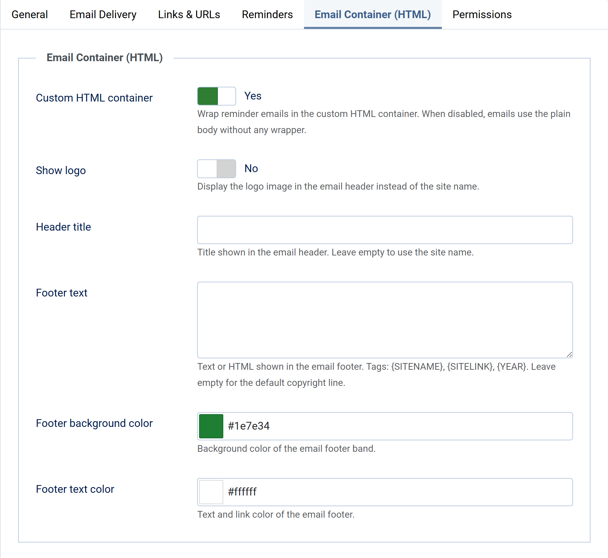
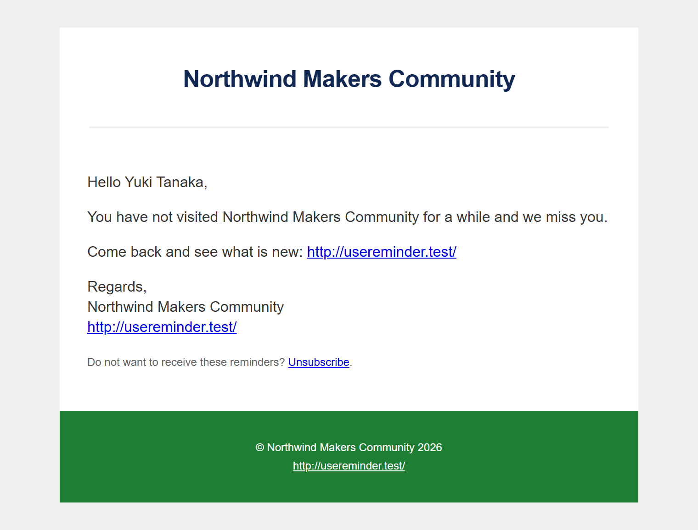

# Email Container

**Components > User Reminder > Options > Email Container (HTML)**

The container is the frame around the HTML body of each reminder: a header with your logo or a title, and a footer. It applies to User Reminder's emails only; Joomla's other emails keep their usual look.

| Option | Default | What it does |
|---|---|---|
| **Custom HTML container** | Yes | Use the frame. No: send the template's HTML body without it |
| **Show logo** | No | Show an image in the header instead of the title |
| **Logo file** | None | The image, from the Media manager. It is embedded in the email, so it shows even when the reader blocks remote images |
| **Header title** | Site name | Text in the header when no logo is shown |
| **Footer text** | © site name and year, with a link | Text or HTML. Tags: `{SITENAME}`, `{SITELINK}`, `{YEAR}` |
| **Footer background color** | `#112855` | |
| **Footer text color** | `#cccccc` | |

## Requirements

- **Joomla 5 or 6.** Joomla 4 cannot pass the container to mail templates; there the template's HTML body is sent as it is.
- **HTML mail format.** **System > Mail Templates > Options > Mail format** must be **HTML** or **HTML and plain text**. The installer sets it, unless you had chosen one already.
- The installer selects **userreminder** as the HTML layout under **System > Mail Templates > Options**. If you change it, User Reminder's emails lose the container.
