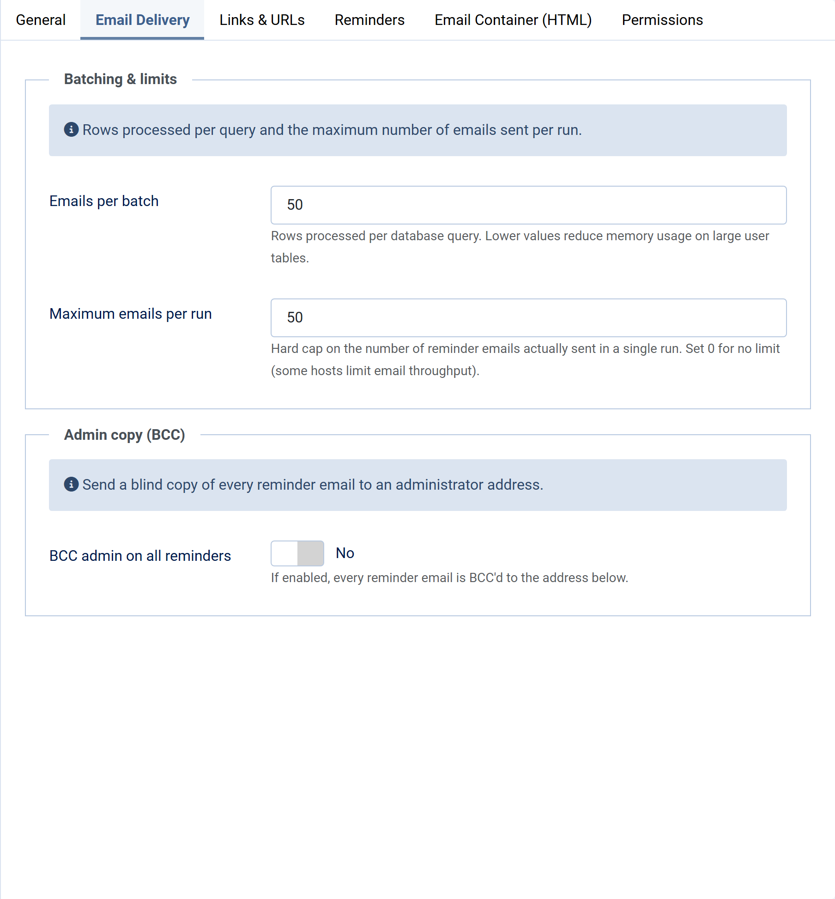

# Email Delivery

**Components > User Reminder > Options > Email Delivery**

## Batching & limits

| Option | Default | What it does |
|---|---|---|
| **Emails per batch** | 50 | Users read from the database per run and reminder group. Lower values use less memory on very large sites |
| **Maximum emails per run** | 20 | The most emails one run sends. `0` = no limit |

Users who don't fit in a run go out in the next runs. If many users are due, the [dashboard](../features/dashboard.md) warns that the backlog is bigger than one run.

Check your host's limit on emails per hour, then pick the cap and how often the [task](../features/scheduling.md) runs. For example, a cap of 50 with the task every hour sends at most 1,200 emails a day.

## Admin copy (BCC)

| Option | Default | What it does |
|---|---|---|
| **BCC admin on all reminders** | No | Send a hidden copy of every reminder to the address below |
| **BCC email address** | Empty | Where the copies go |

Use it while you start, to see exactly what users receive. Test emails get the copy too. The dashboard warns when the copy is on but no valid address is set.
