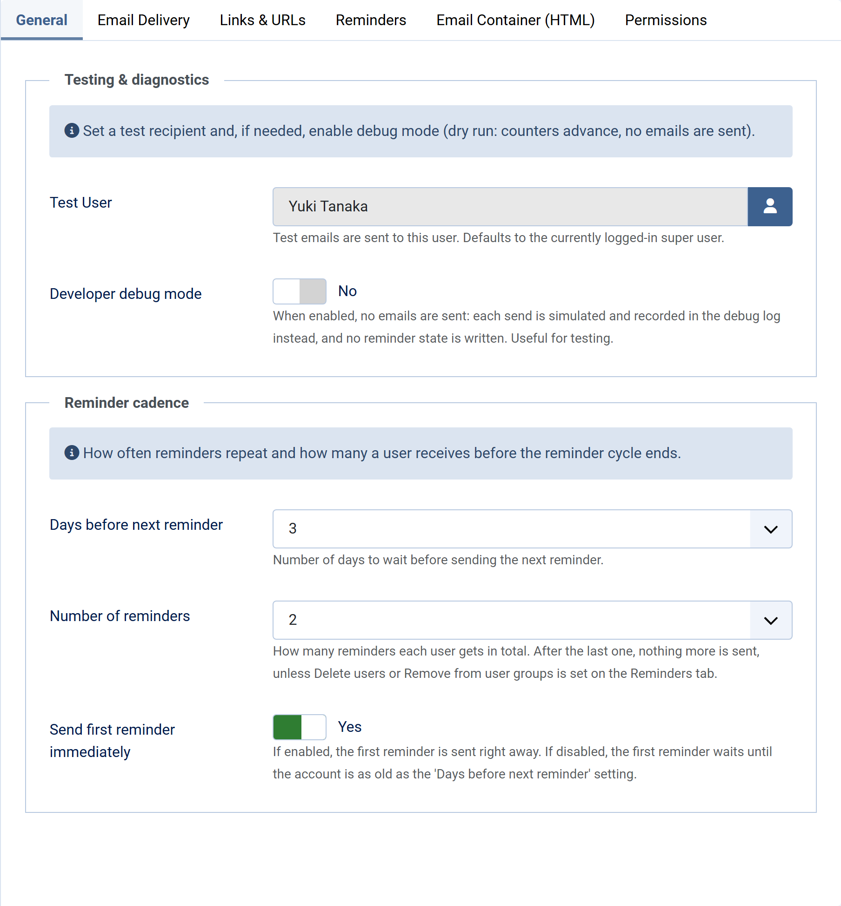

# General

**Components > User Reminder > Options > General**

The General tab sets the reminder cadence for all three reminder types (how many reminders, how far apart, when the first one goes out) and the tools for testing.

## Testing & diagnostics

| Option | Default | What it does |
|---|---|---|
| **Test User** | You | Who gets the **Send Test Email** emails |
| **Developer debug mode** | No | Every run becomes a dry run: nothing is sent or saved, the emails are written to a log file. See [Testing](../features/testing.md) |

## Reminder cadence

These apply to all three reminder types.

| Option | Default | What it does |
|---|---|---|
| **Days before next reminder** | 1 | Days between two reminders to the same user. Without **Send first reminder immediately**, also the minimum account age for the first activation or never-logged-in reminder |
| **Number of reminders** | 1 | Reminders each user gets in total. After the last one nothing more is sent, unless [cleanup](../features/account-cleanup.md) is set |
| **Send first reminder immediately** | No | Yes: the first activation or never-logged-in reminder goes out on the next run after registration |

For inactive users, the first reminder goes out once they pass the **Inactivity threshold** on the [Reminders tab](reminders.md).

**Example:** 3 days between reminders and 3 reminders: a user who registered and never activated gets reminders on day 3, 6 and 9 (with the daily task).
