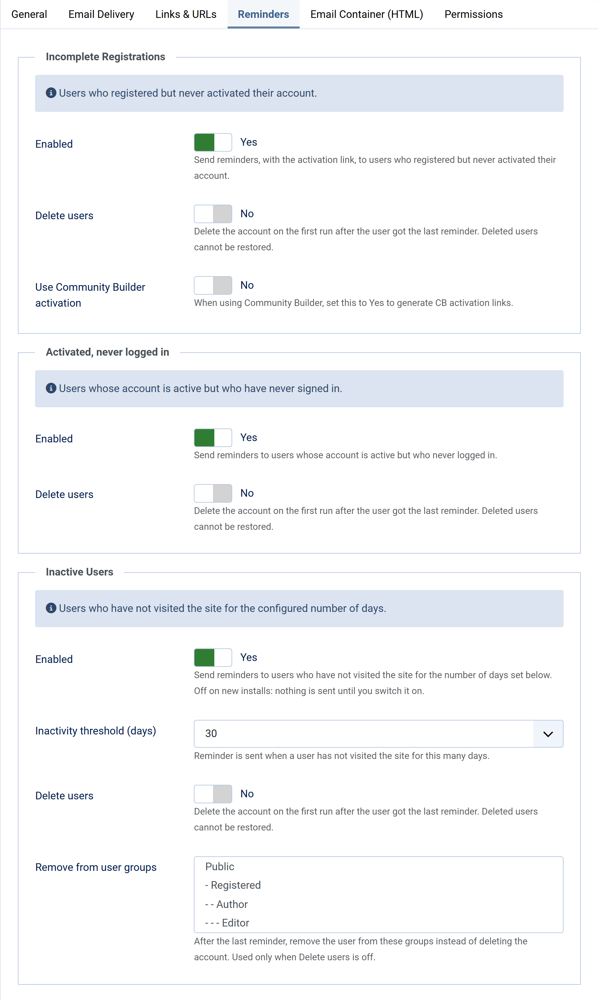
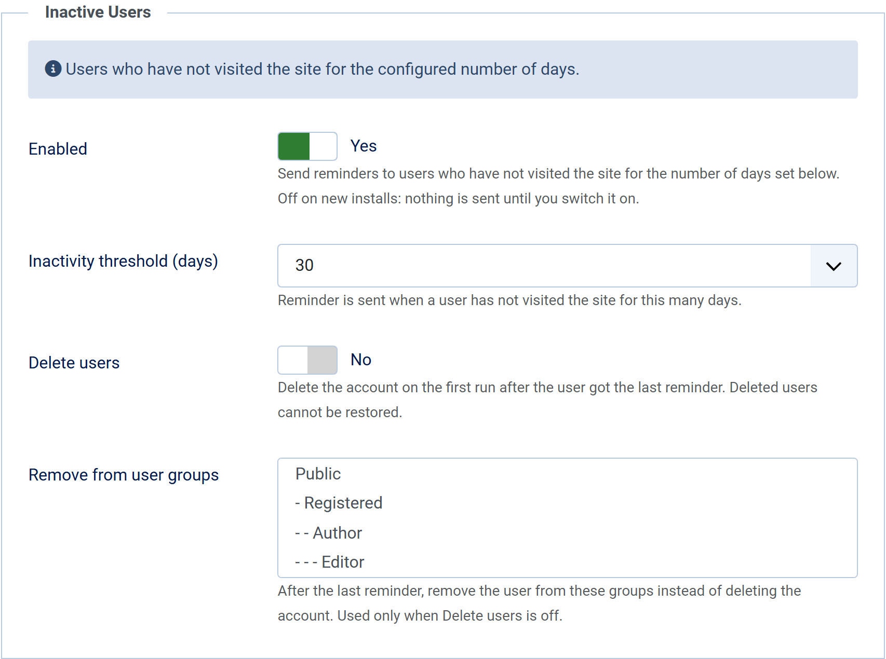

# Reminders

**Components > User Reminder > Options > Reminders**. All reminder types are off on a new install.

## Incomplete Registrations

| Option | Default | What it does |
|---|---|---|
| **Enabled** | No | Send [activation reminders](../features/activation-reminders.md) |
| **Delete users** | No | Delete the account after the last reminder |
| **Use Community Builder activation** | No | Use CB activation links. See [Community Builder](../integrations/community-builder.md) |

## Activated, never logged in

| Option | Default | What it does |
|---|---|---|
| **Enabled** | No | Send [never-logged-in reminders](../features/login-reminders.md) |
| **Delete users** | No | Delete the account after the last reminder |

## Inactive Users

| Option | Default | What it does |
|---|---|---|
| **Enabled** | No | Send [inactive-user reminders](../features/inactive-users.md) |
| **Inactivity threshold (days)** | 180 | Days without a visit before the first reminder |
| **Delete users** | No | Delete the account after the last reminder |
| **Remove from user groups** | None | After the last reminder, take the user out of these groups instead. Used when **Delete users** is off |

Deleting and removing from groups are explained in [Account cleanup](../features/account-cleanup.md).
