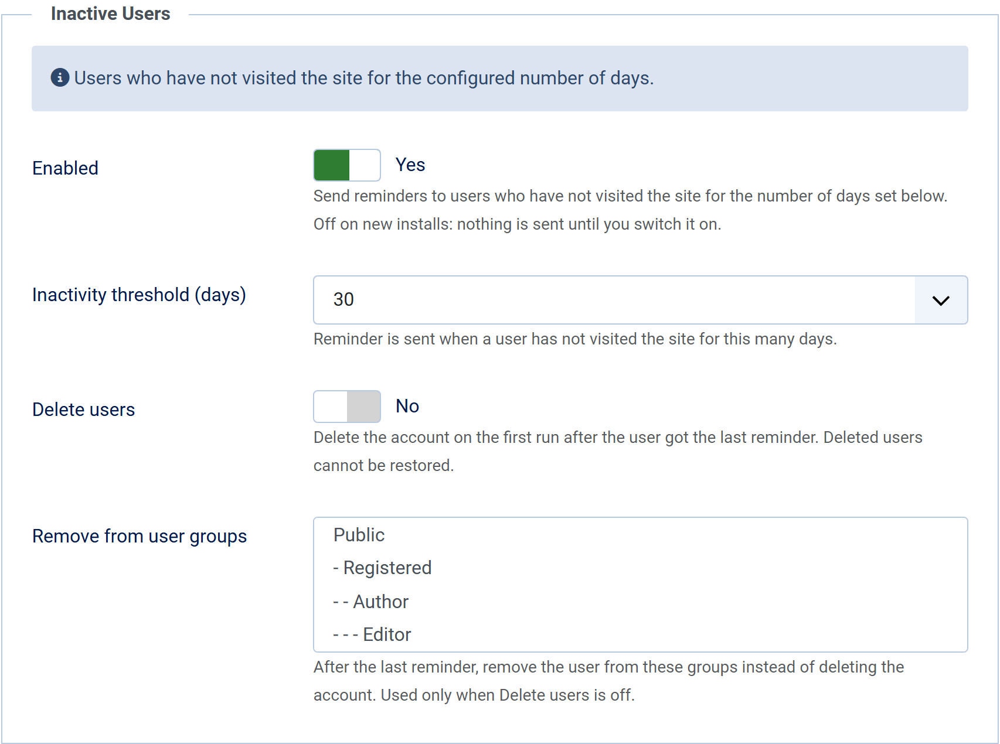

# Account cleanup

When a user got every reminder and still did not react, User Reminder can clean up the account. Both options are off by default.

## Delete users

**Options > Reminders** has a **Delete users** switch for each reminder type. When it is on, the first run after a user's last reminder deletes the account through Joomla, like deleting it in **Users > Manage**.

- Only users who got the full **Number of reminders** are deleted
- Users who opt out, or are in an opt-out group, are never deleted
- The lists show **Delete user** in **Action to Perform** before it happens
- The dashboard shows a red alert while any **Delete users** switch is on

Deleted users cannot be restored. Make a backup first, and check the lists before you switch it on.

## Remove inactive users from groups

For inactive users only, you can take the user out of chosen groups instead of deleting the account. Pick the groups in **Options > Reminders > Inactive Users > Remove from user groups**.

After the last reminder, the next run removes the user from those groups. The account stays, and the user keeps their other groups. Use this to end access to members-only content, for example.

If **Delete users** is also on for inactive users, deletion wins.

## What happens with neither

Nothing. The user stays in the list with **All reminders sent** and gets no more emails.
