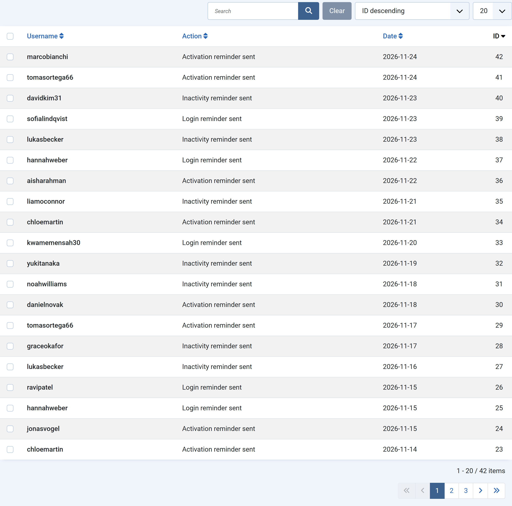

# Action log

**Components > User Reminder > Action Log** records every reminder sent, every unsubscribe and every resubscribe, with the user and the date.

## What is logged

| Entry | When |
|---|---|
| Activation reminder sent | An [activation reminder](activation-reminders.md) went out |
| Login reminder sent | A [never-logged-in reminder](login-reminders.md) went out |
| Inactivity reminder sent | An [inactive-user reminder](inactive-users.md) went out |
| User opted out of reminders | The user confirmed on the [unsubscribe page](opt-out.md) |
| User resubscribed to reminders | The user clicked **Resubscribe** on that page |

Test emails and [dry runs](testing.md) are not logged. The entries are shown in your administrator language, whatever language was active when they were written.

## Search and clean up

- Search by username or action, sort by any column
- **Clear log** deletes the ticked entries, or every entry when none is ticked (you confirm first)
- **Prune old logs** removes entries older than 12 months

Deleting log entries does not change any reminder counters.
