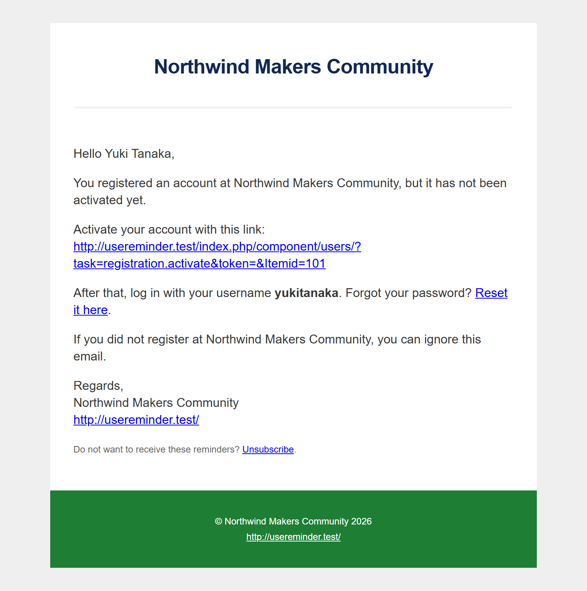
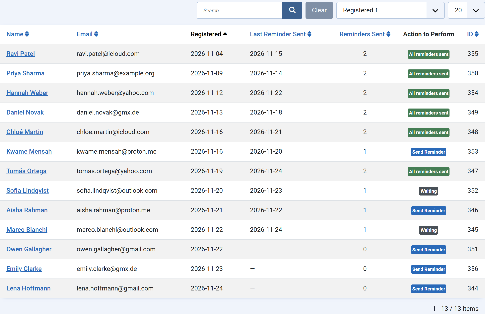

# Activation reminders

Activation reminders go to people who registered but never clicked the activation link. The email carries the activation link again.

## Who gets one

A user gets an activation reminder when all of these are true:

- the account is **blocked** and still has an **activation token** (Joomla's state for "registered, not activated")
- the user **never logged in**
- the user is not on the [opt-out list](opt-out.md) and not in an [opt-out group](opt-out.md#opt-out-groups)
- the account is at least **Days before next reminder** old, unless **Send first reminder immediately** is on

After the first reminder, the next one goes out when **Days before next reminder** have passed, until the user has had the **Number of reminders**.

Accounts an administrator blocked by hand have no activation token, so they never get this reminder.

## Switch it on

**Options > Reminders > Incomplete Registrations > Enabled**. See [Reminders options](../configuration/reminders.md).

## The email

The template is **User Reminder: registration activation reminder** in **System > Mail Templates**. The activation link comes from the `{ACTIVATE_URL}` tag. It points to Joomla's own activation page, or to your own path set on [Links & URLs](../configuration/links.md). With Community Builder, see [Community Builder](../integrations/community-builder.md).

## The list

**Components > User Reminder > Registration Reminders** lists these users together with the [never-logged-in](login-reminders.md) ones.

| Column | Shows |
|---|---|
| Registered | When the account was created |
| Last Reminder Sent | Date of the latest reminder, empty if none yet |
| Reminders Sent | How many reminders this user got |
| Action to Perform | What the next run does: **Send Reminder**, **Waiting**, **All reminders sent**, **Delete user** or **Reminders off**. Hover for the reason |

## When the reminders run out

After the last reminder nothing more is sent. If **Delete users** is on for this type, the next run deletes the account. See [Account cleanup](account-cleanup.md).
