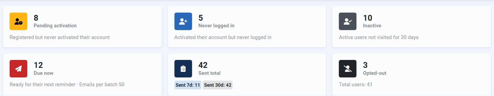
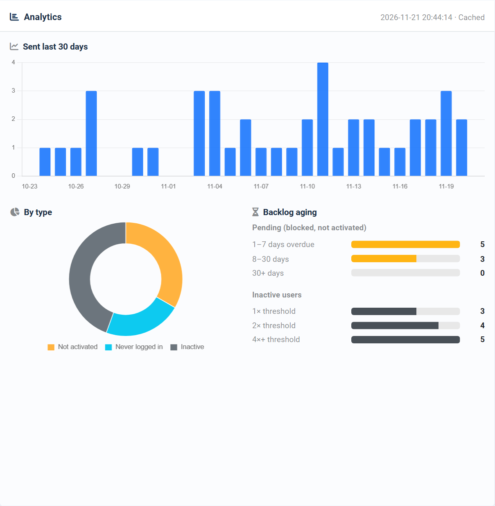
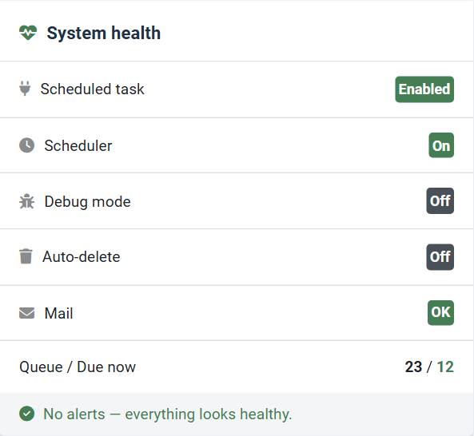
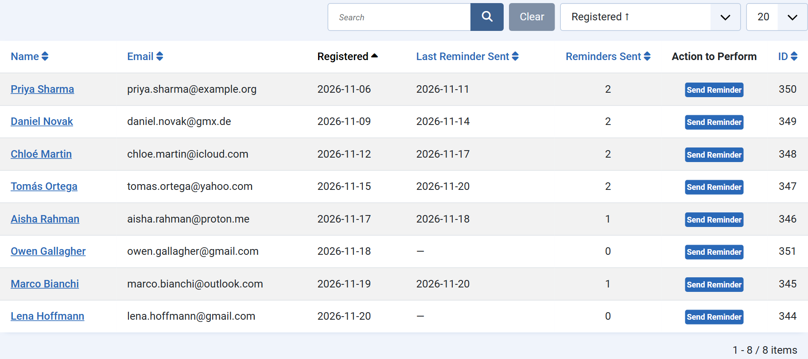
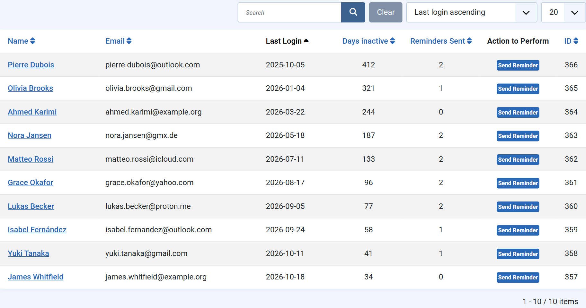
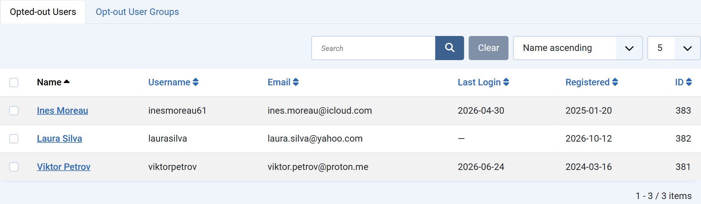
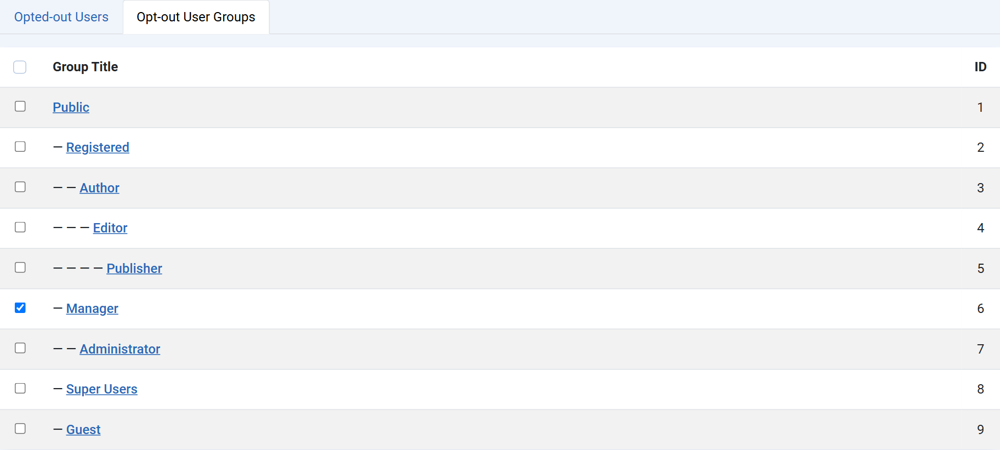
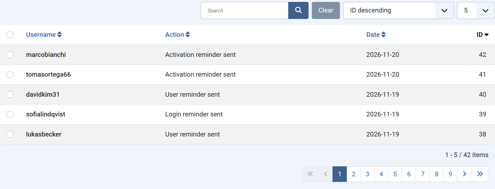
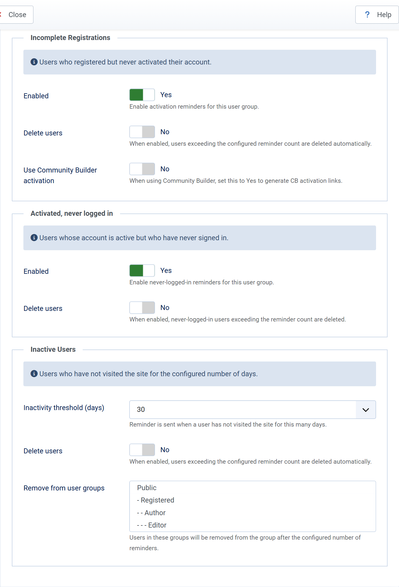

# Administrator Screens

All screens are in the **Components > User Reminder** menu.

## Dashboard

- **Counters**: pending activation, never logged in, inactive, due now, sent (total, 7 days, 30 days), opted out and total users
- **Alerts**: scheduled task missing, debug mode on, deletion on, invalid site mail address, missing BCC address, backlog bigger than a batch
- **Analytics**: emails sent in the last 30 days, split by type, and backlog aging
- **System health** and a **config snapshot** of your main options
- **Recent sends**, oldest pending activations and longest inactive users
- **Quick actions**: send now, send inactive reminders, view log, prune old logs

The dashboard is cached; click **Refresh** for fresh numbers.

## Registration Reminders

Users who never activated or never logged in, with registration date, last reminder sent, reminders sent and the action the next run will take. Search, sort, and **Send Reminders**.

## Active User Reminders

Users past the inactivity threshold, with last login, days inactive, reminders sent and the next action.

## Opt-out

- **Opt-out Users**: people who unsubscribed or that you added. Click **Add opt-out users**, pick users, then **Add to opt-out list**. Select rows and **Remove from opt-out list** to undo
- **Opt-out Groups**: tick user groups whose members never get reminders, for example Administrator or Staff

## Action Log

Every reminder sent, every opt-out and resubscribe, with user and date. Search by username or action, delete selected entries or clear the log. **Prune old logs** on the dashboard removes entries older than 12 months.

## Options

| Tab | Contains |
|---|---|
| General | Test user, developer debug mode, reminder cadence |
| Email Delivery | Emails per batch, maximum per run, admin BCC |
| Links & URLs | Activation and password reset paths |
| Reminders | The three reminder types, deletion, CB activation, remove from groups |
| Email Container (HTML) | Logo, header, footer and colours |
| Permissions | Who may use and configure User Reminder |
