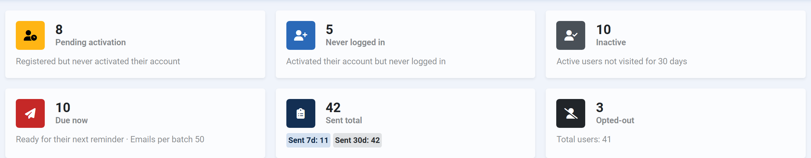
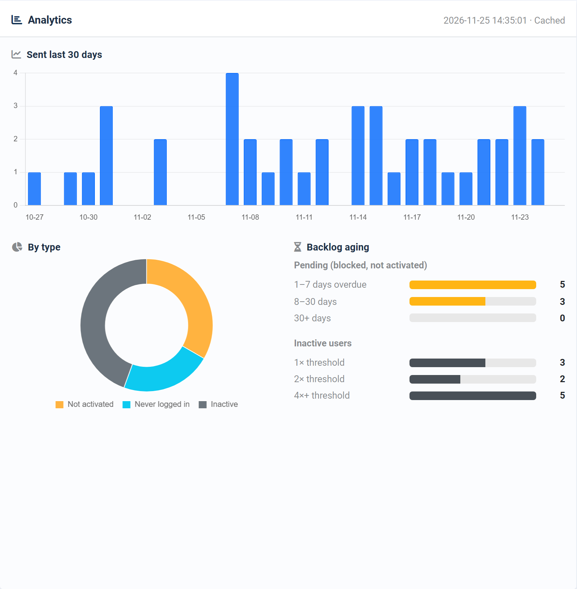
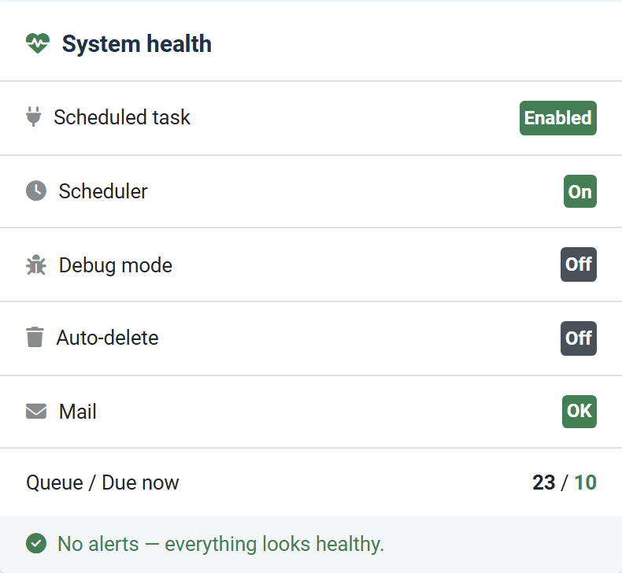

# Dashboard

**Components > User Reminder** opens the dashboard: who is waiting for a reminder, what was sent, and whether the setup is healthy.

## Counters

| Counter | Counts |
|---|---|
| Pending activation | Users who would get an [activation reminder](activation-reminders.md) |
| Never logged in | Users who would get a [never-logged-in reminder](login-reminders.md) |
| Inactive | Users past the inactivity threshold |
| Due now | Users whose next reminder is due and who still have reminders left |
| Sent | Reminders sent in total, in the last 7 and the last 30 days |
| Opted out | Users on the opt-out list |

The counters use the same rules as the sending run, so they match the lists and what the next run does.

## Analytics

- **Last 30 days**: reminders sent per day
- **By type**: reminder history split into activation, never logged in and inactive
- **Backlog aging**: pending activations by account age (1-7, 8-30, 30+ days) and inactive users by how far past the threshold they are

## Health and alerts

The dashboard checks your setup and shows an alert when something needs attention:

| Alert | What to do |
|---|---|
| Automatic reminders are not scheduled | Enable the **Task - UserReminder** plugin and the **User Reminder emails** task. See [Scheduling](scheduling.md) |
| Debug mode is on | Nothing is really sent. Turn off **Developer debug mode** when you are done [testing](testing.md) |
| Deleting users is on | Check the lists before the next run. See [Account cleanup](account-cleanup.md) |
| Site mail address is invalid | Set a valid **From email** in **System > Global Configuration > Server** |
| BCC is on without an address | Enter the address, or turn the copy off. See [Email Delivery](../configuration/email-delivery.md) |
| More users are due than one run sends | Raise **Maximum emails per run**, or run the task more often |

The **Config snapshot** box repeats your main options, and the **Next run** of the scheduled task.

## Recent activity

The last reminders sent, the oldest pending activations and the longest inactive users, each with a link to the full list.

## Refresh

The dashboard is cached for 10 minutes. Click **Refresh** for fresh numbers. Changing an option refreshes it too.
