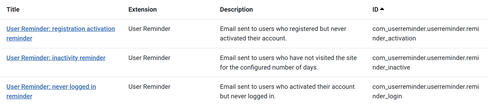

# Email Templates

The reminder emails are Joomla mail templates. Open **Email Templates** in the User Reminder menu, or go to **System > Mail Templates** and filter by **User Reminder**.

## The Three Templates

| Template | Sent to |
|---|---|
| User Reminder: registration activation reminder | Users who registered but never activated |
| User Reminder: never logged in reminder | Users who activated but never logged in |
| User Reminder: inactivity reminder | Users who haven't visited for the inactivity threshold |

Edit the subject, plain text body and HTML body. With several site languages, add a version per language.

## Tags

| Tag | Replaced with |
|---|---|
| `{NAME}` | User's full name |
| `{USERNAME}` | User's username |
| `{SITENAME}` | Site name |
| `{SITELINK}` | Site URL |
| `{ACTIVATE_URL}` | Account activation link (activation reminder only) |
| `{PASSWORD_RESET_URL}` | Password reset link |
| `{OPTOUT_URL}` | Unsubscribe link |

## Email Container

On the **Email Container (HTML)** tab of the options:

- **Custom HTML container**: wrap emails in the User Reminder design, or send the plain body
- **Show logo** and **Logo file**: a logo in the header instead of the site name
- **Header title**: leave empty to use the site name
- **Footer text**: text or HTML, with `{SITENAME}`, `{SITELINK}` and `{YEAR}`
- **Footer background color** and **Footer text color**

## Links

On the **Links & URLs** tab you can change the path of the activation link and the password reset link, for example for a custom registration component. Leave them empty for Joomla's defaults. With Community Builder, turn on **Use Community Builder activation** on the **Reminders** tab instead.

Links are built from your site URL. If the site runs on a local address, the dashboard warns you: set the correct site URL before going live.
