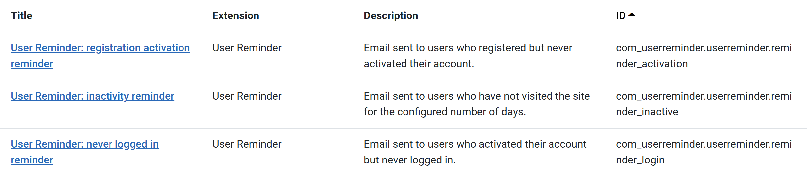
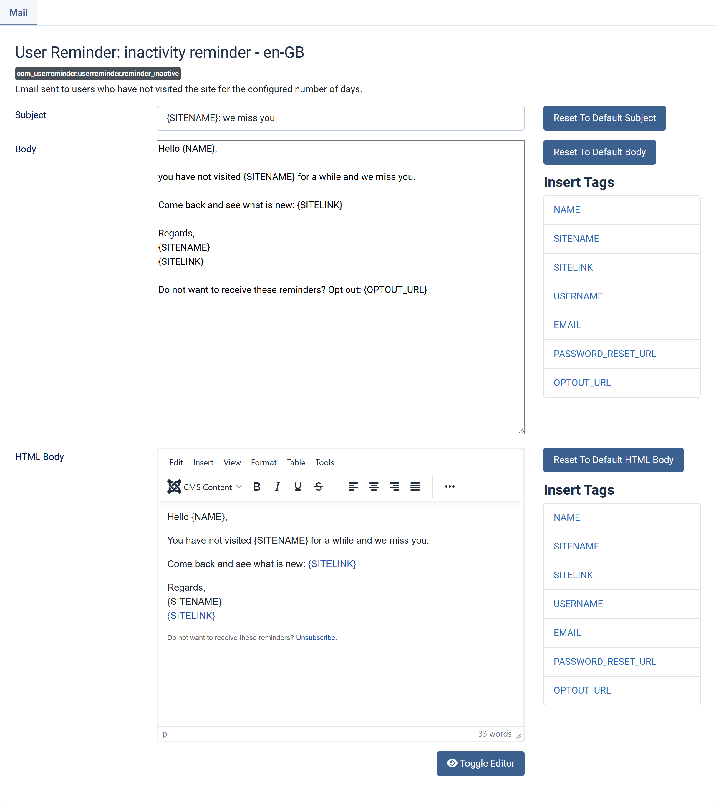

# Email templates

The reminder emails are Joomla mail templates. Click **Email Templates** in the User Reminder menu, or go to **System > Mail Templates** and filter by **User Reminder**.

## The three templates

| Template | Sent to |
|---|---|
| User Reminder: registration activation reminder | Users who registered but never activated |
| User Reminder: never logged in reminder | Users who activated but never logged in |
| User Reminder: inactivity reminder | Users who have not visited for the inactivity threshold |

Open a template to edit its **subject**, **body** (plain text) and **HTML body**. With several site languages, add a version per language. The scheduled task sends in the site's default language; **Send Reminders** in the administrator sends in your administrator language.

## Tags

Click a tag under the editor to insert it.

| Tag | Replaced with |
|---|---|
| `{NAME}` | User's full name (the username when the name is empty) |
| `{USERNAME}` | User's username |
| `{EMAIL}` | User's email address |
| `{SITENAME}` | Site name |
| `{SITELINK}` | Site address |
| `{ACTIVATE_URL}` | Account activation link (activation reminder) |
| `{PASSWORD_RESET_URL}` | Password reset link |
| `{OPTOUT_URL}` | Unsubscribe link |

Keep `{OPTOUT_URL}` in every email, so people can stop the reminders. See [Opt-out](opt-out.md).

## HTML or plain text

The installer sets **System > Mail Templates > Options > Mail format** to **HTML and plain text**, unless you had chosen a format already. Users then get both parts and their mail program shows the HTML one. With **Plain text** only, the HTML body is never sent.

## The email container

On Joomla 5 and 6 the HTML body is placed in the User Reminder container: your logo or a title at the top, a footer with your text and colours at the bottom. Set it up in [Email Container options](../configuration/email-container.md).
