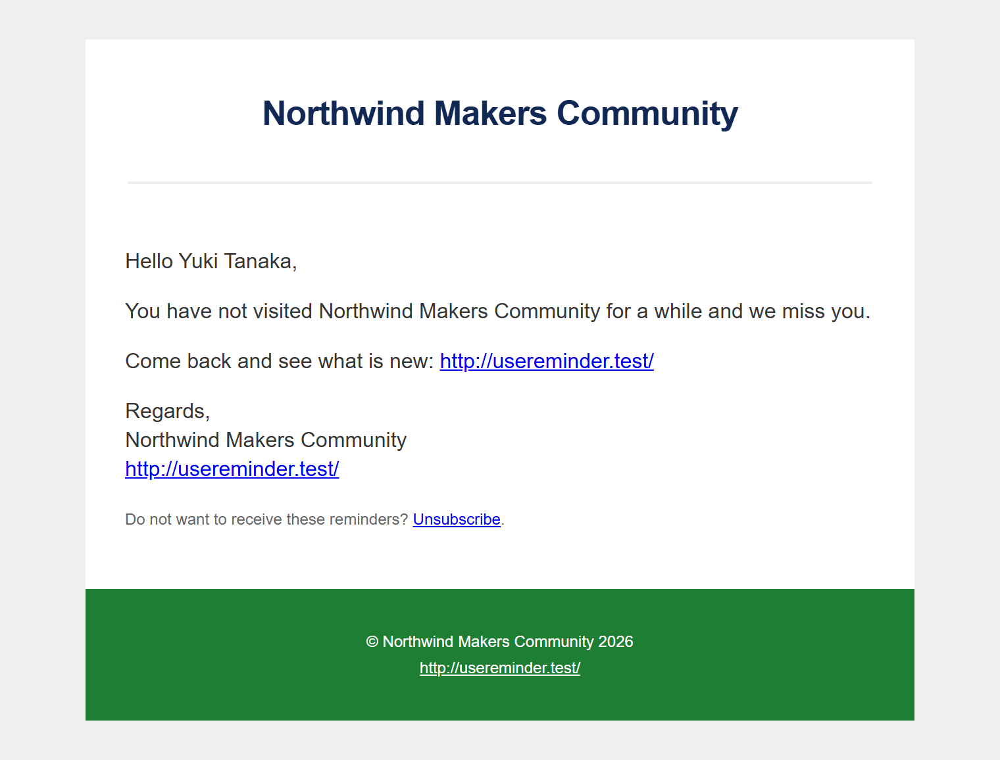
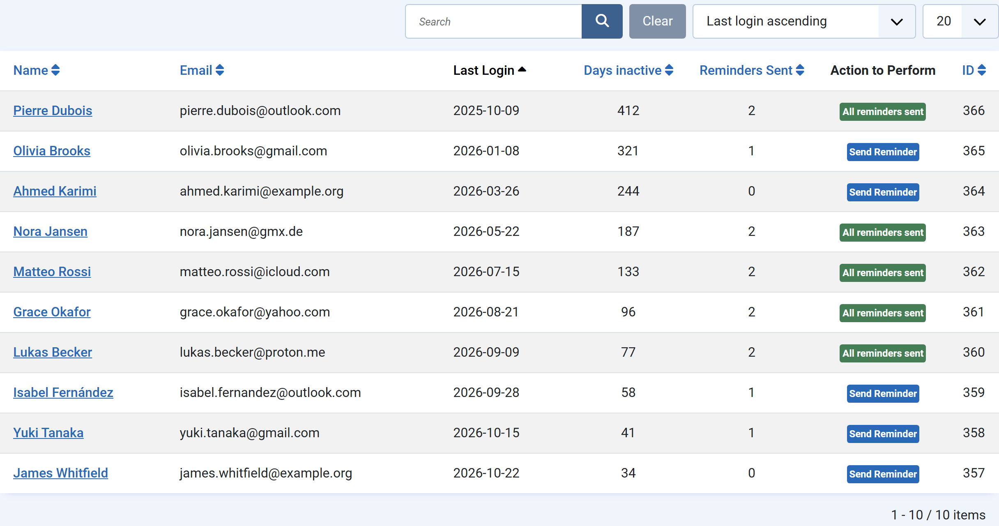

# Inactive-user reminders

Inactive-user reminders go to people who used to log in but have not visited for a number of days you choose.

## Who gets one

- the account is **active** and the user **has logged in before**
- the last visit is longer ago than the **Inactivity threshold (days)**
- the user is not on the [opt-out list](opt-out.md) and not in an [opt-out group](opt-out.md#opt-out-groups)

The first reminder goes out as soon as a user passes the threshold. The next ones follow every **Days before next reminder**, until the user has had the **Number of reminders**. When the user logs in again, they drop out of the list.

## Switch it on

**Options > Reminders > Inactive Users > Enabled**, and set the **Inactivity threshold (days)**, for example 90. See [Reminders options](../configuration/reminders.md).

Inactive-user reminders are off on a new install. Sites updated from a version without this switch keep them on.

## The email

The template is **User Reminder: inactivity reminder**. It invites the user back with `{SITELINK}`.

## The list

**Components > User Reminder > Active User Reminders** lists everyone past the threshold.

| Column | Shows |
|---|---|
| Last Login | The user's last visit |
| Days inactive | Days since that visit |
| Last Reminder Sent / Reminders Sent | What they got so far |
| Action to Perform | What the next run does, including **Remove from groups** |

## When the reminders run out

After the last reminder, the next run can **delete** the account or **remove it from chosen user groups**. With neither set, nothing more happens. See [Account cleanup](account-cleanup.md).
