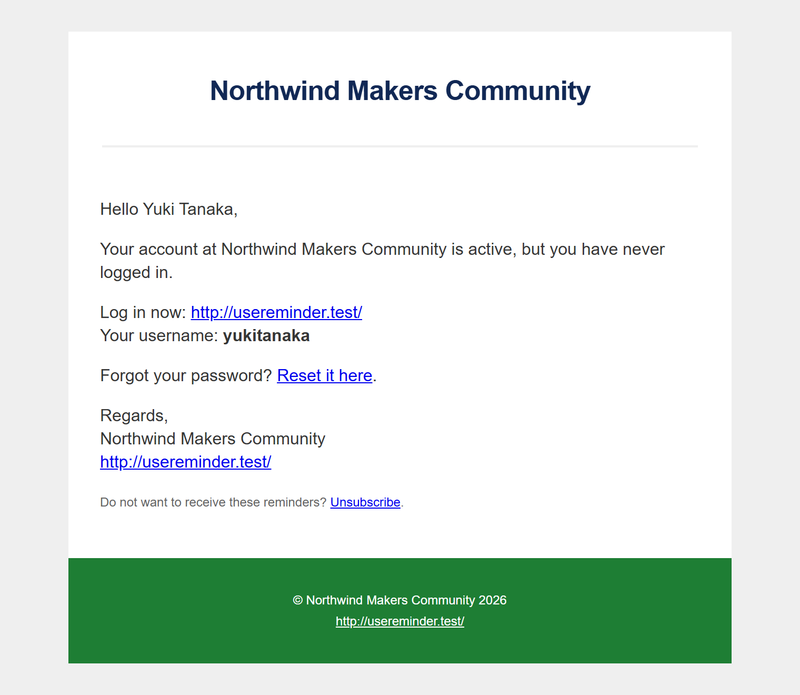

# Never-logged-in reminders

These reminders go to people whose account is active but who never logged in. The email links to your site and gives their username and a password-reset link.

## Who gets one

- the account is **active** (not blocked, no activation token)
- the user **never logged in**
- the user is not on the [opt-out list](opt-out.md) and not in an [opt-out group](opt-out.md#opt-out-groups)
- the account is at least **Days before next reminder** old, unless **Send first reminder immediately** is on

This covers users an administrator created, users who activated but stopped there, and sites where registration needs no activation.

## Switch it on

**Options > Reminders > Activated, never logged in > Enabled**. See [Reminders options](../configuration/reminders.md).

## The email

The template is **User Reminder: never logged in reminder**. It uses `{SITELINK}`, `{USERNAME}` and `{PASSWORD_RESET_URL}`. The reset link goes to Joomla's password reset page, or your own path set on [Links & URLs](../configuration/links.md).

## The list

These users appear in **Registration Reminders** with the activation reminders. See [the list](activation-reminders.md#the-list).

## When the reminders run out

After the last reminder nothing more is sent. If **Delete users** is on for this type, the next run deletes the account. See [Account cleanup](account-cleanup.md).
