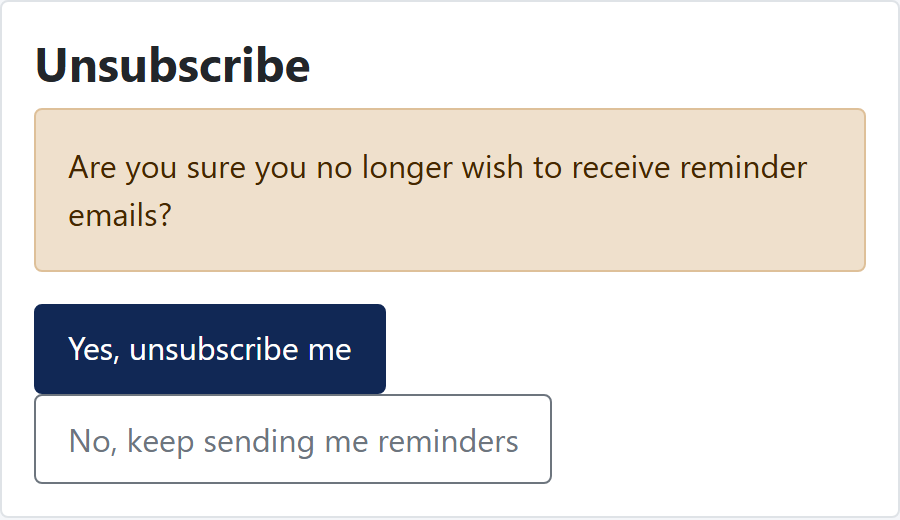
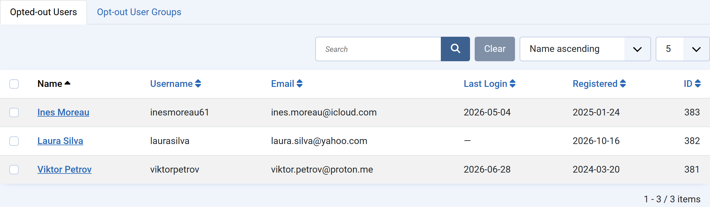
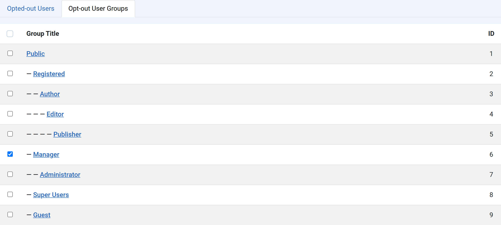

# Opt-out

People can stop the reminders themselves, and you can leave out single users or whole user groups.

## The unsubscribe link

Every template has an `{OPTOUT_URL}` link. It opens a page on your site that asks the user to confirm.

Only the button unsubscribes. Opening the link alone changes nothing, so a mail scanner that follows links does not unsubscribe anyone. After confirming, the same page offers to resubscribe. Both actions are written to the [action log](action-log.md).

The link stays valid: each user keeps the same code, so links in older emails still work.

## Opt-out Users

**Components > User Reminder > Opt-out** lists everyone who unsubscribed or that you added.

- **Add opt-out users**: pick users in Joomla's user picker, then **Add to opt-out list**
- Tick rows and click **Remove from opt-out list** to send them reminders again

## Opt-out Groups

Members of these groups never get reminders and are never deleted. Use it for administrators, staff or partners. Open **Opt-out > User Groups**, tick the groups and save.

A user in an opt-out group who clicks **Resubscribe** still gets no reminders while they are in that group.
