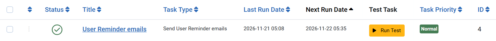

# Scheduling

User Reminder sends automatically through Joomla's **Scheduled Tasks**.

## The Task



The installer creates a task called **User Reminder emails** of type **Send User Reminder emails**, running every 24 hours. Find it in **System > Scheduled Tasks**.

Open it to change:

- **Execution rule**: every few minutes, hours, days or a cron expression
- **Run registration reminders**: include incomplete registrations and never-logged-in users
- **Run inactivity reminders**: include inactive users

You can make two tasks, for example registration reminders every day and inactivity reminders once a week.

If the task is missing or disabled, the dashboard shows **Automatic reminders are not scheduled** with a button to Scheduled Tasks. Create a new task of type **Send User Reminder emails** there.

## How Joomla Runs Tasks

Joomla starts due tasks in one of two ways:

- **Lazy scheduler** (default): a site visit triggers due tasks. Fine for sites with daily traffic.
- **Server cron**: more reliable. Turn off the lazy scheduler in **System > Scheduled Tasks > Options** and add a cron job on your server:

```
php /path/to/your/site/cli/joomla.php scheduler:run --all
```

## Cadence

These options on the **General** tab decide what is due:

| Option | Effect |
|---|---|
| Days before next reminder | Wait between two reminders to the same user |
| Number of reminders before deleting | Reminders per user; after the last one the cycle ends |
| Send first reminder immediately | Yes: first reminder as soon as the user qualifies. No: wait the number of days first |

## Limits

On the **Email Delivery** tab:

- **Emails per batch**: users read per database query (lower uses less memory)
- **Maximum emails per run**: a hard cap per run; `0` means no limit

If more users are due than one run sends, the rest go out in the next runs. The dashboard warns about backlog pressure.

## Send by Hand

**Send Reminders** in the toolbar of **Registration Reminders** or **Active User Reminders** sends what is due right now, with the same rules.
