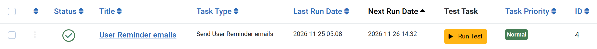
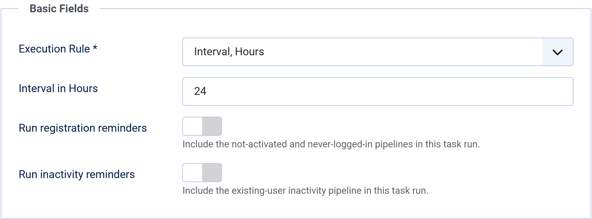

# Scheduling

User Reminder sends automatically through Joomla's **Scheduled Tasks**.

## The task



The installer creates a task called **User Reminder emails** of type **Send User Reminder emails**, running every 24 hours. Find it in **System > Scheduled Tasks**. Open it to change:

- **Execution rule**: every few minutes, hours, days, or a cron expression
- **Run registration reminders**: activation and never-logged-in reminders
- **Run inactivity reminders**: inactive-user reminders



You can make two tasks, for example registration reminders every day and inactivity reminders once a week. A reminder type that is off in the options is never sent, whatever the task says.

If the task is missing or disabled, the [dashboard](dashboard.md) shows **Automatic reminders are not scheduled**. Create a new task of type **Send User Reminder emails** in **System > Scheduled Tasks**.

## How Joomla starts tasks

- **Lazy scheduler** (Joomla's default): a visit to the site starts due tasks. Fine for sites with daily visitors.
- **Server cron** (more reliable): turn off the lazy scheduler in **System > Scheduled Tasks > Options** and add a cron job, for example every 15 minutes:

```
php /path/to/your/site/cli/joomla.php scheduler:run --all
```

## What is due

These options on the **General** tab decide when a user gets the next reminder:

| Option | Effect |
|---|---|
| Days before next reminder | Wait between two reminders to the same user |
| Number of reminders | Reminders per user; after the last one the cycle ends |
| Send first reminder immediately | Yes: activation and never-logged-in reminders start as soon as the user qualifies. No: they wait until the account is as old as the days above |

## Limits per run

On the **Email Delivery** tab, **Maximum emails per run** caps the emails one run sends (`0` = no limit). Users that don't fit go out in the next runs. See [Email Delivery](../configuration/email-delivery.md).

## Send by hand

**Send Reminders** on **Registration Reminders** or **Active User Reminders**, or the send buttons on the dashboard, send what is due right now, with the same rules and limits. The message after the run says how many users were checked, emailed and deleted.

## The task log

Each run writes one line to the task's log in **System > Scheduled Tasks**, for example `Processed 12, sent 5, deleted 0, skipped 7, mail errors 0`.
