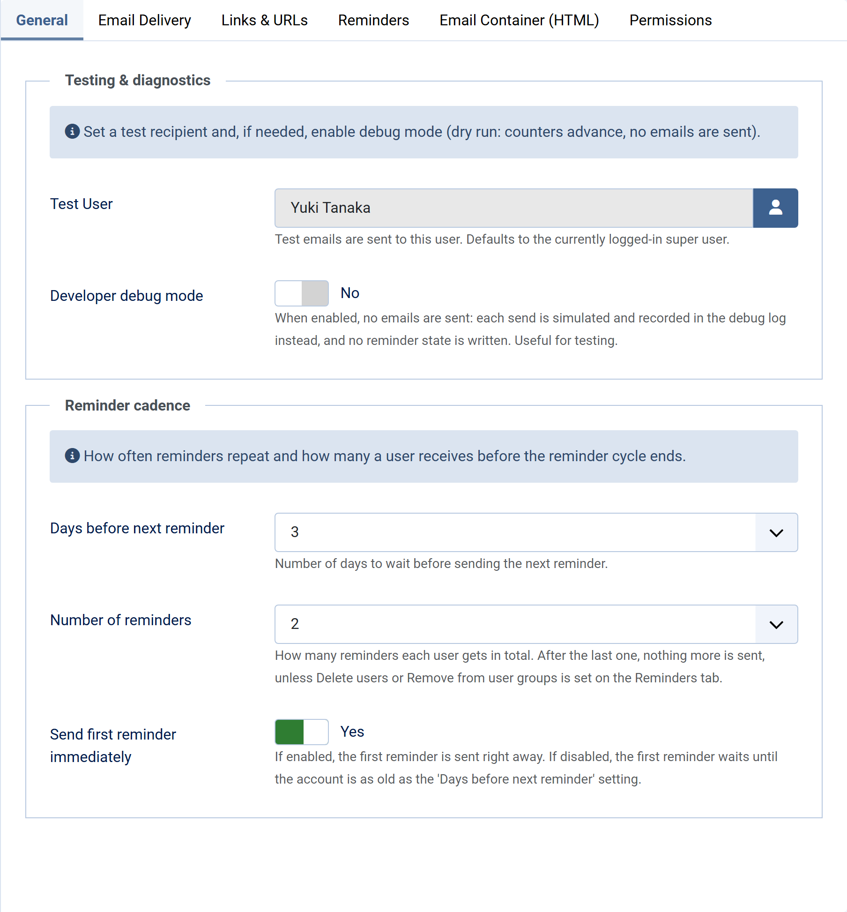
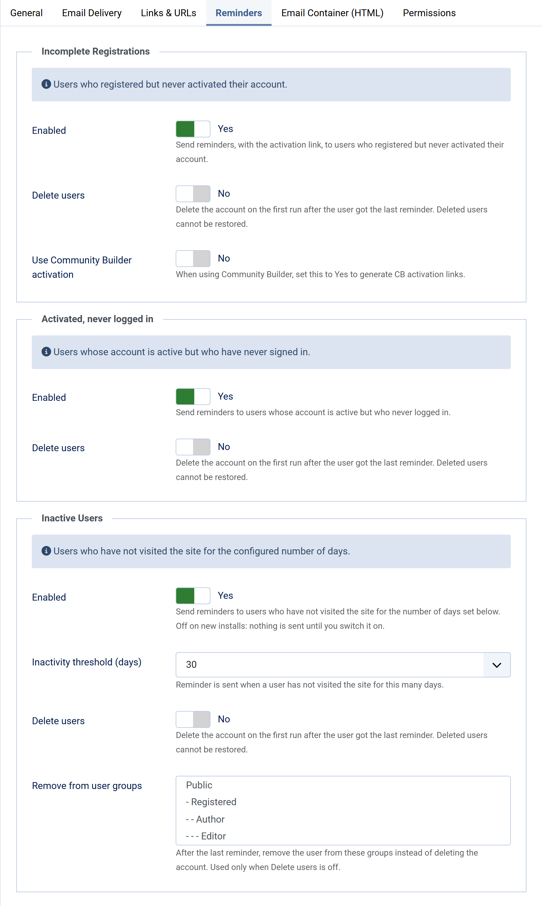
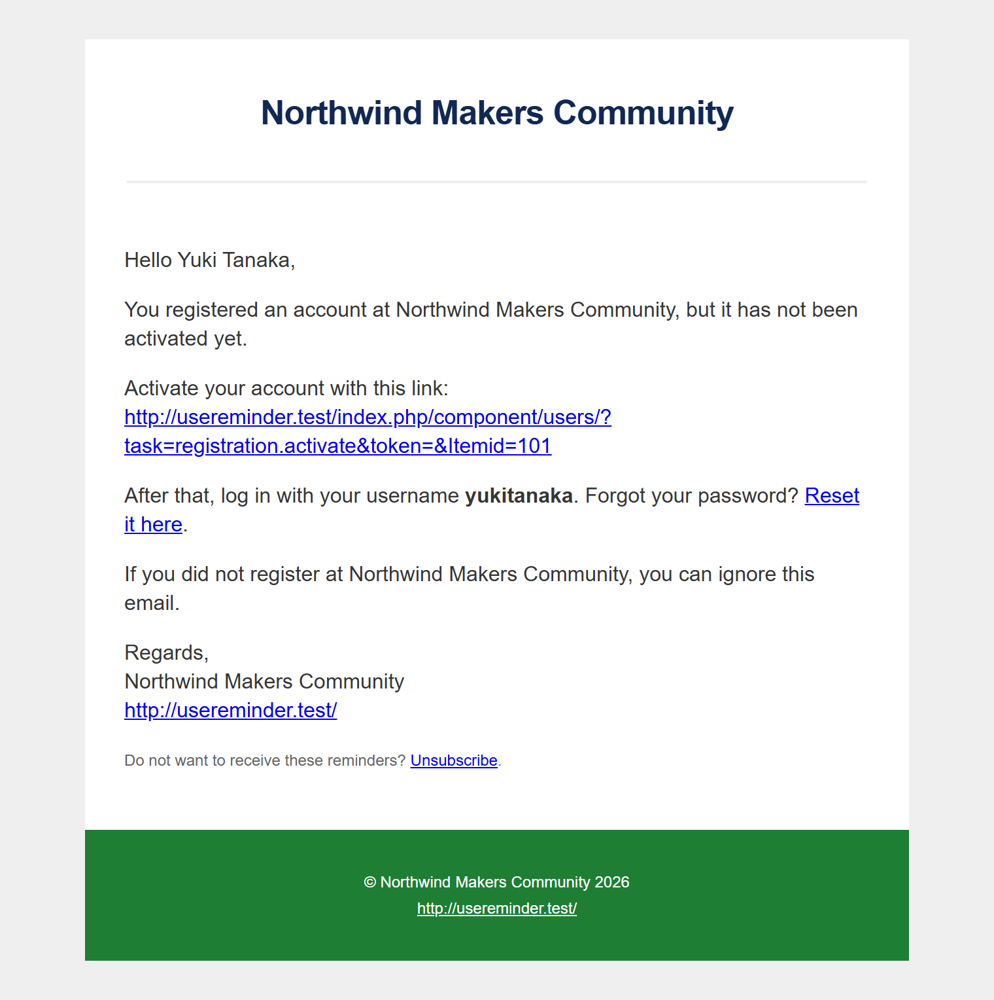

# Quick Start

Send your first reminders in four steps. See [Installation](installation.md) if User Reminder is not installed yet.

## Step 1: Set the cadence

Go to **Components > User Reminder** and click **Options**. On the **General** tab:

1. **Days before next reminder**: the wait between two reminders to the same user
2. **Number of reminders**: how many reminders each user gets in total
3. **Send first reminder immediately**: send the first one as soon as a user qualifies, or wait the number of days first
4. **Test User**: who gets the test emails (empty = you)

## Step 2: Switch on the reminder types you want

On the **Reminders** tab, switch on **Incomplete Registrations**, **Activated, never logged in** and/or **Inactive Users**. For inactive users, set the **Inactivity threshold (days)**. Leave **Delete users** off for now, and click **Save & Close**.

## Step 3: Check the emails

Click **Email Templates** in the User Reminder menu. This opens **System > Mail Templates** filtered to the three reminder emails. The default texts work as they are; change the wording if you like. See [Email templates](features/email-templates.md).

Then open **Registration Reminders** and click **Send Test Email**. Check your inbox.

## Step 4: See who is next, then let it run

**Registration Reminders** and **Active User Reminders** list the users each type will email. The **Action to Perform** column says what the next run does for each one: send, wait, delete, or nothing more.

Click **Send Reminders** to send now, or leave it to the **User Reminder emails** scheduled task, which runs every 24 hours. See [Scheduling](features/scheduling.md).

## What happens next

- **Every day:** the task sends what is due, within your [sending limits](configuration/email-delivery.md)
- **A user gets the last reminder and does not react:** nothing more happens, unless you switch on **Delete users** or choose groups to remove inactive users from. See [Account cleanup](features/account-cleanup.md)
- **A user clicks the unsubscribe link:** they confirm on your site and get no more reminders. See [Opt-out](features/opt-out.md)
