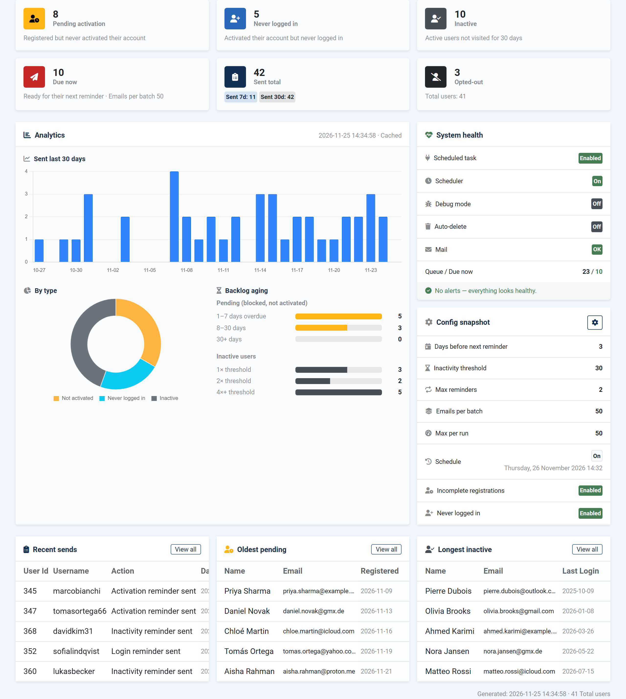

# User Reminder

**User Reminder** is a Joomla extension that emails users who never activated their account, never logged in, or stopped visiting, and can clean up the accounts that never respond.

## What it does

User Reminder looks at your Joomla users and finds three kinds of quiet accounts:

- **Incomplete registrations**: registered, but never activated
- **Never logged in**: activated, but never signed in
- **Inactive users**: no visit for a number of days you choose

Each group gets its own email, repeated as often as you set. When the last reminder goes unanswered, User Reminder can delete the account or, for inactive users, remove it from chosen user groups.

It uses Joomla's own parts: the emails are **Joomla Mail Templates**, sending runs as a **Joomla Scheduled Task**, and all data stays in your site's database. No outside service sees your users.

## What's included

| Part | What it does |
|---|---|
| **com_userreminder** | Dashboard, reminder lists, opt-out lists, action log, options and the unsubscribe page |
| **plg_task_userreminder** | The "Send User Reminder emails" task in **System > Scheduled Tasks** |
| **plg_installer_userreminderupdate** | Lets Joomla download updates with your download key |

## Where to start

- New here: [Installation](installation.md), then the [Quick Start](getting-started.md)
- Everything it can do: [Features](features.md)
- Is it right for your site: [Use Cases](product-overview/use-cases.md), [Benefits](product-overview/benefits.md), [Why Choose It](product-overview/why-choose-it.md) and [Compatibility](product-overview/compatibility.md)
- Something not working: [Troubleshooting](troubleshooting.md) and the [FAQ](faq.md)
- Who may use it: [Permissions](configuration/permissions.md)

## Support

- **Website:** [joomcoder.com](https://www.joomcoder.com/)
- **Email:** support@joomcoder.com
- **Licence:** GNU General Public License v2 or later
